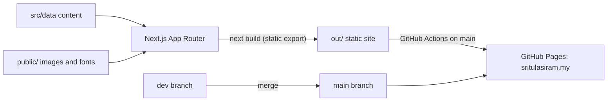

# Sri Tulasi Ram — Portfolio

Source for [sritulasiram.my](https://sritulasiram.my): engineering case studies, UI/UX design work and photography from a support engineer at [Cytron Technologies](https://www.cytron.io) in Penang, Malaysia.


[](https://github.com/sritulasiram/sritulasiram.github.io/actions/workflows/deploy.yml)


## What's in the site

| Section | Route | Contents |
| :-- | :-- | :-- |
| Home | `/` | Hero, selected systems, key numbers, design and photography teasers |
| Projects | `/projects` | Directory, impact summary, side-by-side comparison |
| Project case study | `/projects/[id]` | Background, architecture, outcomes, screens. Also `/specs` and `/compare` sub-pages |
| Designs | `/designs` | Showcase with foundations, icons, typography and workflow kits |
| Design case study | `/designs/[id]` | Phone and laptop walkthroughs of each design |
| Photography | `/photography` | Gallery, lightbox and per-photo camera details |
| About | `/about` | Journey timeline, credentials, recognition |

**Features**

- **Spotlight-style search** (`⌘K` or `/`) across pages, projects, designs and photos, driven by [`src/data/searchData.ts`](src/data/searchData.ts).
- **Light and dark themes** that follow the system setting, are remembered, and load without a flash.
- **Per-project accent colours** from [`src/data/projectTheme.ts`](src/data/projectTheme.ts), exposed as `--pa*` CSS variables.
- **Privacy-safe photography.** Published photos carry no GPS data, and camera details are stored in `content.ts`, not read from the files.
- **Static export** (`output: "export"`), so the site is plain files with no server runtime.
- **Maintenance mode** that publishes the whole site as an "upgrading" screen.

## How it fits together



## Case studies

**Projects**

| Id | Project |
| :-- | :-- |
| `warranty-rma` | Warranty & RMA Management System |
| `raspberry-pi-diagnostics` | Raspberry Pi Diagnostic Suite |
| `iot-fertiliser-mixing` | IoT-Based Fertiliser Mixing for Precision Farming |
| `opencore-efi-hackintosh` | OpenCore EFI Hackintosh Architecture |
| `rog-gaming-center` | ROG Gaming Center for macOS |
| `cytron-hr-assistive-intelligence` | Cytron HR Assistive Intelligence |

**Designs:** `sage`, `recycle-ai`, `kopiesatu`, `pmc-clinic`, `void`.

## Getting started

Requires Node.js 20.9 or later (CI uses Node 22).

```bash
git clone https://github.com/sritulasiram/sritulasiram.github.io.git
cd sritulasiram.github.io
git checkout dev
npm install
npm run dev
```

The dev server runs at <http://localhost:3000>.

| Command | What it does |
| :-- | :-- |
| `npm run dev` | Dev server (webpack) |
| `npm run build` | Static export to `out/` |
| `npm run start` | Serve a production build |
| `npm run lint` | ESLint |
| `npx tsc --noEmit` | Type check |

### Maintenance mode

```bash
NEXT_PUBLIC_MAINTENANCE_MODE=true npm run build
```

Every route renders the "upgrading" screen. The flag is read in [`src/app/layout.tsx`](src/app/layout.tsx).

## Project structure

```text
public/
  CNAME, _headers, fonts/
  images/<kind>/<slug>/       photography, projects, designs, portraits, logos, ...
docs/                         Architecture, content, deployment and security guides
.github/workflows/            GitHub Pages deploy
src/
  app/                        App Router: home, about, projects, designs, photography, maintenance
  components/
    layout/                   Navigation, mega menu, footer, search modal, theme toggle
    home/ projects/ designs/  Feature sections (projects/ has case-studies/ and visuals/)
    about/ photography/       Feature sections
    shared/ mockups/ ui/      Shared pieces, device frames, primitives
  data/                       All content and structured data (see below)
  lib/cn.ts                   Class-name helper
  types/index.ts              Shared types
```

## Editing content

Content lives in `src/data`, not in components.

| To change | Edit |
| :-- | :-- |
| Bio, credentials, global copy | `content.ts` |
| A project case study | `projectDetails.ts` (also `projectSpecs.ts`, `projectCompare.ts`, `projectTheme.ts`) |
| A design case study | `designDetails.ts` |
| Search results and quick links | `searchData.ts` |
| Photos | `content.ts` (`PHOTOGRAPHY_DATA`) and `photoHighlights.ts` |

To add a project, add an entry to `PROJECT_DETAILS`, put its images in `public/images/projects/<id>/`, give it an accent in `projectTheme.ts`, and add a search entry.

## Conventions

- **Components:** one per file, `PascalCase.tsx`, file name matches the default export. Folders are by feature, not by type. Keep the feature prefix when a name would otherwise be ambiguous (`DesignHeroStage` vs `ProjectsHeroStage`).
- **Non-component modules** (constants, config, hooks, helpers, data): `camelCase.ts(x)`, such as `homeShared.tsx`, `appStudies.tsx`, `useMediaQuery.ts`, `projectDetails.ts`.
- **Routes:** lowercase folder names under `src/app`; dynamic segments are `[id]`.
- **Images:** `public/images/<kind>/<slug>/<descriptive-name>.<ext>`, lowercase kebab-case. A project's folder name equals its id in `src/data`.
- **Imports:** use the `@/` alias across folders; relative paths only within a folder.
- **Colour:** use the `--pa*` variables on project pages instead of hex values. Body text must meet 4.5:1 contrast in both themes.
- **Page titles:** the homepage tab is `Sri Tulasi Ram`. Subpages use the bare page title (`About`, `Projects`, `[Project Title]`) with no author suffix, and layouts keep `template: "%s"`.
- **Design direction:** follow apple.com product pages: neutral light bands, one dark band, large two-tone headlines, colour only for interactive and key elements.

## Deployment

The site deploys to GitHub Pages from `main` through [`.github/workflows/deploy.yml`](.github/workflows/deploy.yml). Work happens on `dev`; merging into `main` publishes. [`public/CNAME`](public/CNAME) maps the custom domain, and the full setup is in [docs/deployment.md](docs/deployment.md).

[`vercel.json`](vercel.json) and [`public/_headers`](public/_headers) carry security and cache headers for hosts that read them. GitHub Pages ignores both.

## Documentation

| Guide | Covers |
| :-- | :-- |
| [Architecture](docs/architecture.md) | Stack, rendering model, directory map, data flow, theming, search |
| [Content guide](docs/content-guide.md) | Editing content, adding projects, designs and photos, conventions |
| [Deployment](docs/deployment.md) | Branch model, GitHub Pages setup, DNS, go-live checklist |
| [Security](docs/security.md) | Current posture, known gaps, release checklist |

## Notes for AI agents

This repo uses a Next.js version with breaking changes. Read [`AGENTS.md`](AGENTS.md) and the guides in `node_modules/next/dist/docs/` before changing framework-level code.

## Author

Designed and built by [Sri Tulasi Ram](https://sritulasiram.my).

## License

Copyright © 2026 Sri Tulasi Ram. All rights reserved.

This is a personal portfolio. The source is public so you can see how it's built, but it is not open source. You can read it, fork it on GitHub and run it locally to learn from it. Please don't deploy it, reuse its design or content for your own site, or use the photography, designs or writing without permission. See [LICENSE](LICENSE) for the full terms.
