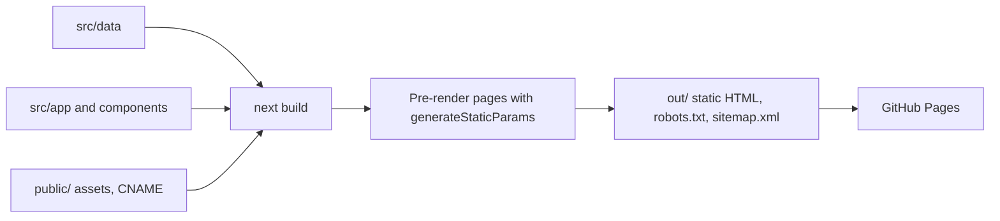
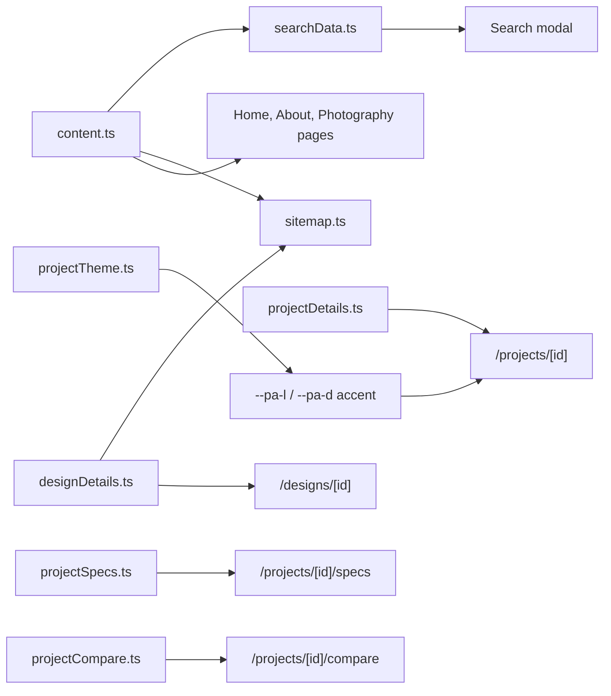

# Architecture

The site is a statically exported Next.js App Router project. There is no server at runtime: every page is rendered to HTML at build time and published from `out/`.

## Stack

| Layer | Choice |
| :-- | :-- |
| Framework | Next.js 16 (App Router, `output: "export"`) |
| UI | React 19, Tailwind CSS 4 |
| Language | TypeScript 5.9 |
| Motion | GSAP |
| Icons | lucide-react, Font Awesome (brand and utility icons) |
| Fonts | Inter and Instrument Serif via `next/font/google`; Roboto Flex and Open Sans (Designs page only); a Material Symbols subset in `public/fonts` |

> This Next.js version has breaking changes from older releases. Read the guides in `node_modules/next/dist/docs/` and [`AGENTS.md`](../AGENTS.md) before changing framework-level code.

## Imports and aliases

`tsconfig.json` maps `@/*` to `src/*`. Use `@/` across folders and relative paths only within a folder.

## Rendering model

- `next.config.ts` sets `output: "export"` and `images.unoptimized`, so `next/image` serves files as they are.
- Dynamic routes (`/projects/[id]`, `/projects/[id]/specs`, `/projects/[id]/compare`, `/designs/[id]`) export `generateStaticParams`, so every case study is pre-rendered from the data files.
- `robots.ts` and `sitemap.ts` are `force-static` and build into `robots.txt` and `sitemap.xml`. The sitemap is generated from the same project and design data.
- `not-found.tsx` and `error.tsx` render the shared `MaintenanceScreen`.

## Build pipeline



## Directory map

```text
src/
  app/                  Routes, layouts, metadata, robots and sitemap
  components/
    layout/             Navigation, mega menu, footer, search modal, theme toggle
    home/               Home page sections
    projects/           Directory, hero, comparison, specs
      case-studies/     One component per project case study
      visuals/          Diagrams and bento grids used by case studies
    designs/            Showcase, kits (foundations, icons, typography, workflow)
    photography/        Gallery, intro morph, highlights, preview modal
    about/              Journey timeline, credentials, statement reveal
    shared/             Reusable pieces (carousel, lightbox, YouTube embed, ...)
    mockups/            Device frames (iPhone, MacBook, laptop)
    ui/                 Small primitives
  data/                 All content and structured data
  lib/cn.ts             Class-name helper (clsx + tailwind-merge)
  types/index.ts        Shared types
public/                 Static assets, `CNAME`, `_headers`
  images/<kind>/<slug>/ apps, awards, certificates, designs, devices, logos,
                        originals, photography, portraits, projects
```

## Data flow

Components read from `src/data`; content is never hard-coded in pages.



## Theming

- Light and dark themes follow the system setting and are remembered in `localStorage`. An inline script in `<head>` ([`src/app/layout.tsx`](../src/app/layout.tsx)) applies the theme before first paint to avoid a flash.
- Project and about pages take an accent from [`src/data/projectTheme.ts`](../src/data/projectTheme.ts) as `--pa*` CSS variables defined in `globals.css`. Use those instead of hard-coded hex values.

## Search

`⌘K` or `/` opens a spotlight-style modal. Results come from [`src/data/searchData.ts`](../src/data/searchData.ts) and are matched client-side, so a new page or project is only searchable once it has an entry there.

## Maintenance mode

`NEXT_PUBLIC_MAINTENANCE_MODE=true` at build time makes the root layout render `MaintenanceScreen` for every route. The flag is read once in `layout.tsx` and is baked in at build, not runtime.

## SEO

- **Metadata:** defaults, Open Graph and Twitter fields are set in the root layout and overridden per page with `metadata` or `generateMetadata`. Title rules are in [`AGENTS.md`](../AGENTS.md): no author suffix on subpages, and `template: "%s"` stays in layouts.
- **Canonical URLs:** every page sets `alternates.canonical`. Project aliases resolve to the canonical project id.
- **Share images:** project and design pages use their own cover image through [`src/lib/seo.ts`](../src/lib/seo.ts) (`pageSocial`). Other pages fall back to the root portrait. A page-level `openGraph` replaces the root one, so use the helper rather than hand-writing it.
- **Sitemap:** `sitemap.ts` lists every route. `lastModified` is the latest commit date (read from git at build time), so it only changes when the source does.
- **Structured data:** a JSON-LD `Person` schema is embedded in the root layout.
- **Crawling:** `robots.ts` allows all bots and points to the sitemap.
