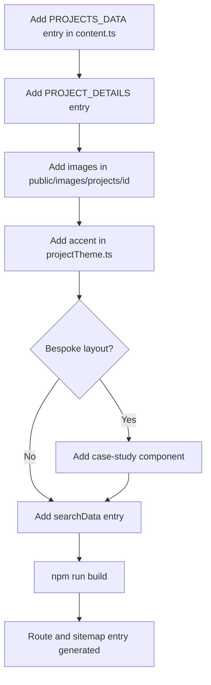
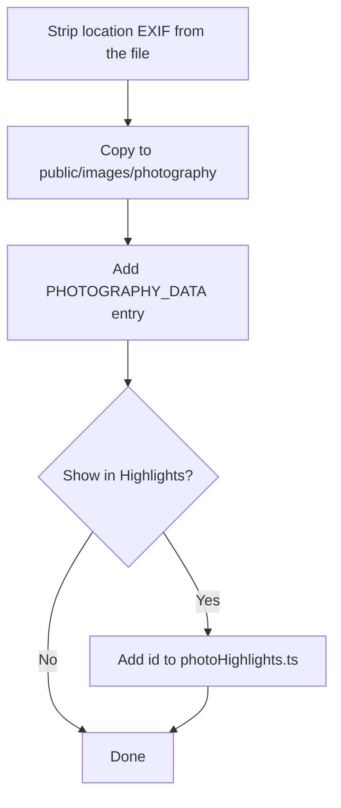

# Content guide

All copy and structured content lives in `src/data`. Components should not need editing for routine updates.

## Where things live

| To change | Edit |
| :-- | :-- |
| Bio, credentials, awards, contact details, global copy | `src/data/content.ts` |
| A project case study (summary, sections, outcomes) | `src/data/projectDetails.ts` |
| Project spec tables and comparison data | `projectSpecs.ts`, `projectCompare.ts` |
| A project's accent colour | `projectTheme.ts` |
| A design case study | `src/data/designDetails.ts` |
| Footer copy | `footerCopy.ts` |
| Which photos appear in Highlights | `photoHighlights.ts` |
| Search results and quick links | `searchData.ts` |

## Add a project




1. Add an entry to `PROJECTS_DATA` in `content.ts` and a matching entry to `PROJECT_DETAILS` in `projectDetails.ts`. The `id` becomes the URL: `/projects/<id>`.
2. Put images in `public/images/projects/<id>/`. The folder name must equal the id.
3. Add an accent to `PROJECT_ACCENTS` in `projectTheme.ts` as `[light, dark]`. The dark value should be brighter. Body text must keep 4.5:1 contrast in both modes.
4. If the project has a bespoke layout, add a component under `src/components/projects/case-studies/`.
5. Add an entry to `searchData.ts`.
6. Run `npm run build`. The sitemap and static routes pick the project up automatically.

## Add a design

Add an entry to `DESIGNS_DATA` and `DESIGN_DETAILS` (both in `designDetails.ts`), put images in `public/images/designs/<id>/`, and add a search entry.

## Add photographs

1. Drop the files in `public/images/photography/` (lowercase kebab-case names).
2. Add the photo to `PHOTOGRAPHY_DATA` in `content.ts`.
3. The photo's category (`coastal`, `urban` or `nature`) controls the gallery filter. Camera details shown in the lightbox are written in the data entry, not read from the file.

**Privacy:** strip location EXIF from the file before publishing (for example `exiftool -gps:all= photo.jpg`). The existing images in `public/images` have been checked and contain no GPS data.



## Accessibility

Body text must meet 4.5:1 contrast in light and dark mode. Pages keep the skip link, `main` landmark (`id="main-content"`) and visible focus outlines; new interactive elements need the same focus style.

## Conventions

- **Components:** one per file, `PascalCase.tsx`, file name matches the default export. Group by feature, not by type.
- **Non-component modules:** `camelCase.ts(x)`.
- **Routes:** lowercase folders under `src/app`; dynamic segments are `[id]`.
- **Images:** `public/images/<kind>/<slug>/<descriptive-name>.<ext>`, lowercase kebab-case.
- **Imports:** use the `@/` alias across folders and relative paths within a folder.
- **Page titles:** the homepage tab is `Sri Tulasi Ram`; subpages use the bare title with no suffix.
- **Design direction:** follow apple.com product pages (neutral bands, one dark band, large two-tone headlines, colour only for key and interactive elements).

## Before you commit

```bash
npm run lint
npx tsc --noEmit
npm run build
```
