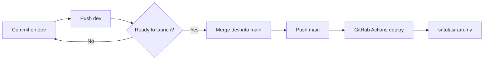
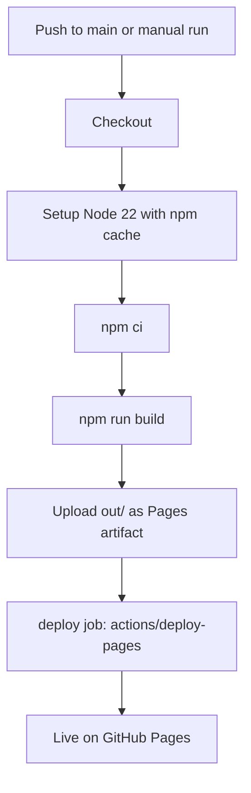
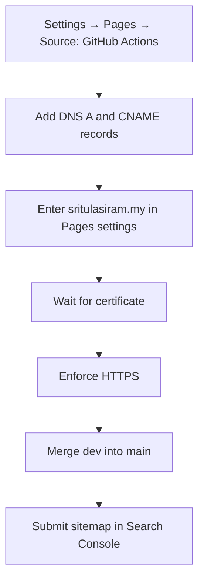

# Deployment

The site is deployed to **GitHub Pages** at <https://sritulasiram.my> by [`.github/workflows/deploy.yml`](../.github/workflows/deploy.yml).

## Branches

| Branch | Purpose |
| :-- | :-- |
| `dev` | Day-to-day development. Pushing here does **not** deploy. |
| `main` | Production. Every push builds and publishes to GitHub Pages. |

Merging `dev` into `main` publishes the site. Until then `main` carries the teaser.



## How a deploy works

1. A push to `main` (or a manual run from the Actions tab) starts the workflow.
2. The `build` job runs `npm ci` and `npm run build` on Node 22 and uploads `out/` as the Pages artifact.
3. The `deploy` job publishes the artifact with `actions/deploy-pages`.



The workflow uses least-privilege permissions (`contents: read`, `pages: write`, `id-token: write`) and cancels superseded runs.

## One-time setup

1. **Pages source:** repo Settings → Pages → Source → **GitHub Actions**.
2. **Custom domain:** `public/CNAME` contains `sritulasiram.my` and ships with every build. Enter the same domain in Settings → Pages.
3. **DNS** for the apex domain, four `A` records:

   ```text
   185.199.108.153
   185.199.109.153
   185.199.110.153
   185.199.111.153
   ```

   Plus a `CNAME` record for `www` pointing to `sritulasiram.github.io`.
4. Tick **Enforce HTTPS** once the certificate is issued.

## Setup order



## Going live checklist

- [ ] `NEXT_PUBLIC_MAINTENANCE_MODE` is not set for the production build.
- [ ] `npm run build` passes locally.
- [ ] Domain verified in Google Search Console and `https://sritulasiram.my/sitemap.xml` submitted.

## Teaser mode

To publish the "upgrading" screen instead of the site, build with `NEXT_PUBLIC_MAINTENANCE_MODE=true`. It is read at build time, so changing it requires a new deploy.

## Security headers

GitHub Pages cannot set custom response headers, so [`public/_headers`](../public/_headers) and [`vercel.json`](../vercel.json) have no effect there. They apply if the site is served from Cloudflare Pages, Netlify or Vercel. See [security.md](security.md).

## Other hosts

The output is plain static files, so `npm run build` followed by serving `out/` works anywhere.

## Troubleshooting

| Symptom | Likely cause and fix |
| :-- | :-- |
| Workflow fails at `npm run build` | Reproduce locally with `npm ci && npm run build`. A type or lint error in `dev` blocks the deploy. |
| Deploy succeeds but the site is unchanged | Hard-refresh; Pages and browsers cache. Confirm the run was on `main`, not `dev`. |
| Custom domain returns a 404 or certificate error | DNS has not propagated or the certificate is still issuing (can take up to an hour or more). Check the four `A` records and the `www` `CNAME`, then re-save the domain in Pages settings. |
| "Enforce HTTPS" is greyed out | The certificate is not ready yet. Wait and retry. |
| Site shows the "upgrading" screen | The build ran with `NEXT_PUBLIC_MAINTENANCE_MODE=true`. Unset it and redeploy. |
| Pages shows the teaser after merging | `main` still points at the old commit, or the Actions run failed. Check the Actions tab. |
| Sitemap not picked up | Submit `https://sritulasiram.my/sitemap.xml` in Search Console and confirm `robots.txt` allows crawling. |

