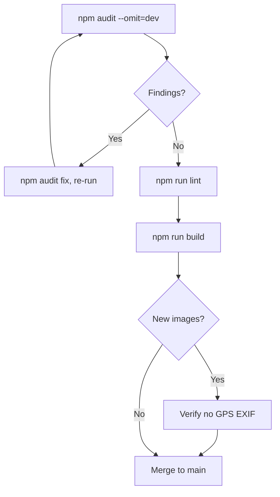

# Security

This is a static site with no server, forms, cookies, authentication or user-supplied input, so the attack surface is small. This page records the posture and the known gaps.

## Reporting a problem

See [SECURITY.md](../SECURITY.md).

## What is in place

- **No secrets** in the code, `.env` files or git history.
- **No tracking scripts.** There are no analytics or advertising tags.
- **Third-party embeds are click-to-load.** The YouTube player loads from `youtube-nocookie.com` only after a visitor presses play.
- **Safe link handling.** Every `target="_blank"` link carries `rel="noopener noreferrer"`.
- **No dynamic HTML.** The only `dangerouslySetInnerHTML` uses are the theme bootstrap script and the JSON-LD block, both built from constants.
- **Photo privacy.** Published images carry no GPS EXIF data, and no location data is stored in the repo.
- **Dependency hygiene.** Run `npm audit` before releases. Production dependencies are currently clean.
- **Least-privilege CI.** The deploy workflow requests only the permissions it needs and runs only on `main`.

## Known gaps

| Gap | Notes |
| :-- | :-- |
| Response headers on GitHub Pages | HSTS, `X-Frame-Options`, `Permissions-Policy` and cache rules in `_headers` / `vercel.json` are not applied. Put Cloudflare in front, or move to a host that reads them. |
| No Content-Security-Policy | Needs a header (or a meta tag with reduced coverage). |
| Build-tooling advisory | `braces` (dev dependency only) has an open advisory. It never ships to production. |

## Release flow



## Release checklist

```bash
npm audit --omit=dev
npm run lint
npm run build
```

Also confirm no new images contain location EXIF data.
